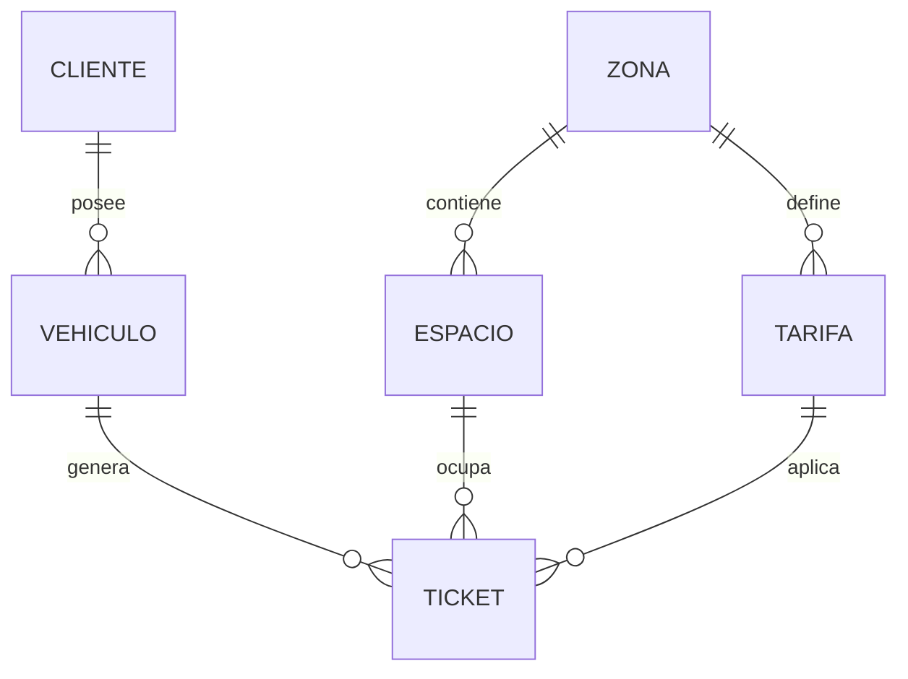

# Sistema de Parqueo

Aplicación web para gestionar un estacionamiento: clientes, vehículos, zonas, espacios, tarifas y tickets de entrada/salida con cobro automático. Incluye reportes, un asistente de IA y control de acceso por roles.

**Asignatura:** Taller de Aplicación en Internet · **Tecnologías:** Python, Flask-AppBuilder 5, MySQL, Git/GitHub · **Modalidad:** individual

## Modelo de datos (6 tablas relacionadas)



| Tabla | Campos principales | Claves foráneas |
|---|---|---|
| `cliente` | nombre, ci (único), teléfono, email | — |
| `vehiculo` | placa (única), marca, modelo, tipo | `cliente_id` |
| `zona` | nombre (único), descripción | — |
| `espacio` | código (único), estado (Libre/Ocupado/Mantenimiento) | `zona_id` |
| `tarifa` | nombre, tipo de vehículo, precio por hora | `zona_id` |
| `ticket` | entrada, salida, monto, estado, observaciones | `vehiculo_id`, `espacio_id`, `tarifa_id` |

## Reglas de negocio (CRUD)

- Un ticket solo puede abrirse en un espacio **Libre**, que pasa a **Ocupado**.
- La tarifa debe coincidir con el **tipo del vehículo** y con la **zona** del espacio.
- Un vehículo no puede tener dos tickets activos a la vez.
- Al registrar la salida (edición o acción «Registrar salida ahora») se calcula el monto: **horas o fracción, mínimo 1 hora**, y el espacio queda Libre.
- Un ticket finalizado no se puede modificar; eliminar un ticket activo libera su espacio.
- No se elimina un espacio ocupado; las placas se guardan en mayúsculas.

## Seguridad

Inicio de sesión obligatorio (rol público sin permisos) y tres roles:

| Rol | Usuario demo | Permisos |
|---|---|---|
| Admin | `admin` / `admin123` | Todo, incluida la administración de usuarios y roles |
| Operador | `operador` / `operador123` | CRUD de clientes, vehículos y tickets; lectura de zonas, espacios y tarifas; reportes e IA |
| Consulta | `consulta` / `consulta123` | Solo lectura, reportes e IA |

> Cambia estas contraseñas antes de cualquier uso real.

## Reportes (Menú «Reportes»)

1. **Ingresos**: total, cantidad y promedio; desglose por día, zona y tipo de vehículo. Filtros: rango de fechas, zona y tipo.
2. **Ocupación por zona**: espacios libres/ocupados/mantenimiento, porcentaje y vehículos estacionados ahora con monto estimado. Filtro: zona.
3. **Historial de vehículos y clientes**: tickets con duración y monto, totales y estadía promedio. Filtros: fechas, placa, nombre o C.I.

Las pruebas verifican que las cifras coinciden con sumas directas sobre la base de datos.

## Inteligencia artificial

Menú **Asistente IA**: consultas en lenguaje natural («¿Qué espacios libres hay?», «¿Cuánto se recaudó hoy?») con la API gratuita de **Google Gemini**. El asistente recibe un resumen de la base (ocupación, tarifas, ingresos, vehículos estacionados) y **nunca datos personales de clientes**.

- Clave gratuita: <https://aistudio.google.com/apikey> → `GEMINI_API_KEY` en `.env`.
- El modelo se configura con `GEMINI_MODEL` (por defecto `gemini-2.5-flash`); si no está disponible se prueban alternativas. Verifica en AI Studio qué modelos y límites tiene tu cuenta gratuita.
- Sin clave, el asistente muestra un aviso y el resumen actual del parqueo.

## Instalación

```bash
git clone <URL-de-tu-repositorio>
cd parqueo-fab
python -m venv venv && source venv/bin/activate      # Windows: venv\Scripts\activate
pip install -r requirements.txt
cp .env.example .env                                  # edita credenciales de MySQL y la clave de Gemini
```

Crear la base en MySQL:

```sql
CREATE DATABASE parqueo CHARACTER SET utf8mb4 COLLATE utf8mb4_unicode_ci;
```

Inicializar (tablas, roles, usuarios y datos de ejemplo) y ejecutar:

```bash
export FLASK_APP=run.py        # Windows: set FLASK_APP=run.py
flask init-db
python run.py                  # http://localhost:8080
```

Si agregas vistas nuevas, ejecuta `flask crear-roles` para actualizar los permisos de Operador y Consulta.

## Pruebas

```bash
python -m pytest -q
```

37 pruebas sobre una base SQLite temporal: acceso y permisos por rol, reglas de negocio, ciclo completo del ticket, reportes contra cálculos directos e IA con la API simulada. Las pruebas no consumen cuota de Gemini.

## Estructura

```
app/models.py        6 tablas          app/reports.py       consultas de reportes
app/views.py         CRUD y reglas     app/report_views.py  vistas de reportes
app/cli.py           init-db, roles    app/ai.py, ai_views.py  asistente IA
app/templates/       reportes y asistente        tests/      pruebas
```

## Control de versiones

Flujo con ramas por funcionalidad, integradas a `main` con `merge --no-ff`:

| Rama | Contenido |
|---|---|
| `feature/modelos` | Las 6 tablas y sus relaciones |
| `feature/crud-seguridad` | CRUD, reglas de negocio, roles, datos de ejemplo |
| `feature/reportes` | Los 3 reportes |
| `feature/ia-asistente` | Integración con Gemini |
| `docs/readme` | Documentación y pruebas de seguridad |

Evidencias para la defensa:

```bash
git log --oneline --graph --all     # historial con ramas y merges
git branch -a                       # ramas utilizadas
git shortlog -sn                    # commits por autor
```
